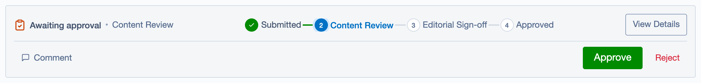
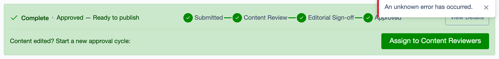
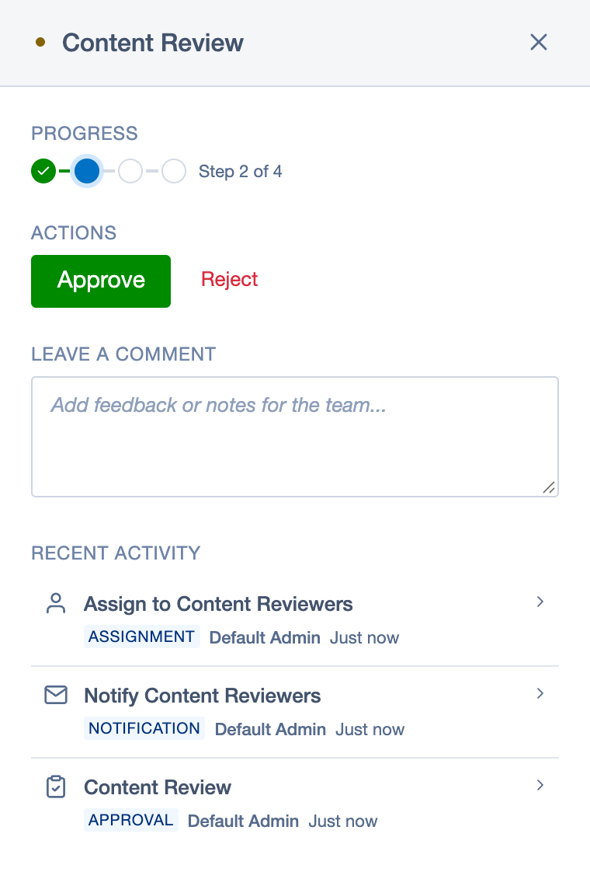

# Using workflows

## Requesting publication (authors)

Depending on the specific permissions content authors have, authors may only have the ability to create or edit content
and to request publication, but not to actually publish content - making it publicly viewable - themselves.

- **Content Author - Non-admin**: To request publication, press the "Apply for Approval" button (or equivalent,
 depending on how your workflow has been setup) in the same bottom menu of the Editing Pane.
- **Content Publisher - Admin**: You will be asked to add a comment about your edits. This comment will become a part of the audit trail for your content, and we recommend adding this information.
However, it is not enforced, and you can safely proceed while leaving this field blank.

Depending on how your workflow is setup, users and/or groups configured with "approval" permissions will be alerted via
email. They are able to login to the CMS and see your page as a pending approval request when they view the Workflow
lefthand navigation menu item in the CMS. The publisher will then need to review your request and publish it.

## Approving and publishing content (publishers)

Depending on the setup of workflow, Content Publishers may receive an e-mail when Content Authors have requested
publication. Publishers then select the 'Workflow' navigation item to view a report of pending items and by selecting
one from the list, are able to access the approval step. In the following screen, the drop-down menu will display the
next approval step based on the workflow for this page. Publishers are also able to enter in comments here, detailing
their approval or cancel/deny the approval, if necessary.

## The workflow status panel

Your site may show a workflow status panel at the top of the page editing screen. When it does, the panel replaces
the workflow buttons at the bottom of the editing pane, and you start, approve and reject workflows from the panel.

### Workflow status

The panel shows where the page is in its workflow:

- **In Progress**: the workflow is moving to its next step.
- **Awaiting approval**: the workflow is waiting for someone to approve or reject the page.
- **Complete**: the workflow approved the page, and it is ready to publish.
- **Rejected**: someone rejected the changes.
- **Published**: the approved changes have been published.

The step tracker shows each stage of the workflow, with completed stages, the current stage and the stages still to
come. The panel also shows who the workflow is assigned to.

### Starting, approving and rejecting

- To request approval, select the button in the panel, for example "Apply for approval".
- To approve or reject, select the matching button in the panel. Rejection buttons are shown in red.
- To add a comment, select *Comment* before you select a button. Comments are optional and become part of the
  page's workflow history.

Any unsaved changes to the page are saved before the workflow moves on.

### Workflow details

Select *View Details* to see who the workflow is assigned to, its progress, the latest feedback and recent activity.
*View Details* is only shown to users who can view the workflow, such as the people assigned to it and the person who
started it.

### Publishing after approval

Once a workflow has approved a page, anyone who can normally publish the page can publish it. If the page, or content
that belongs to it such as content blocks or files, changes after the approval, the page needs a new approval before
it can be published.
