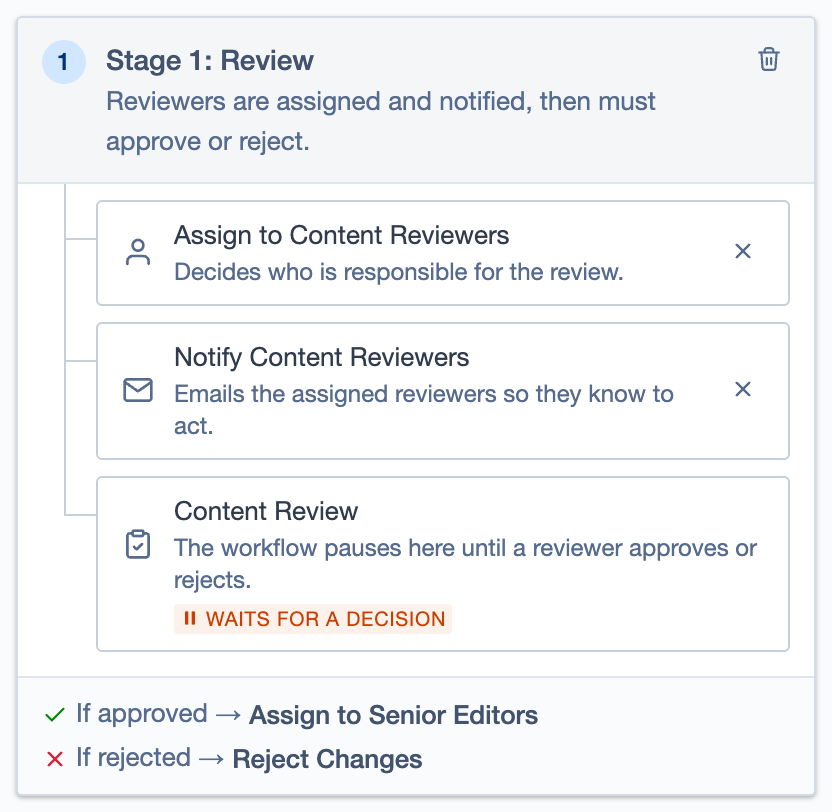
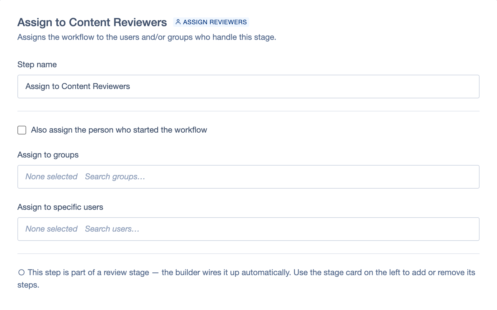

# Building workflows with the visual builder

The *Visual builder* tab shows a workflow as a series of **review stages**, so you can build and change a workflow
without wiring up each action and transition by hand.

You need the "Create workflow" permission to use the visual builder. See
[workflow users and permissions](workflow-permissions.md).

## Opening the visual builder

1. Select *Workflows* in the left-hand navigation menu.
1. Select the workflow you want to change, or create a new one.
1. Select the *Visual builder* tab.

While the workflow loads, the builder shows "Loading workflow…". If it can't be loaded, the builder shows a message
explaining why (for example, that you don't have permission to edit the workflow) and a *Try again* button. You can't
save the workflow until it has loaded.

## Review stages

Each review stage assigns reviewers, notifies them, and then waits for them to approve or reject the content. Approved
content moves on to the next stage. Rejected content follows the rejection path.

- To start a new workflow, select *Add your first review stage*. The builder creates the standard steps for the stage
  and a rejection path, all connected for you.
- To add another stage, select *Add a review stage*. You can also add a stage between two existing stages.
- To remove a stage and its steps, use the remove button on the stage card.
- To publish content automatically once the last stage approves it, select *Add "publish when approved"*.

### Adding optional steps to a stage

Use *Add to this stage* on a stage card to add optional steps, such as a notification email. To take an optional step
out again, use the remove button next to it.

A step marked as waiting for a decision is where the workflow stops until someone approves or rejects the content.

## Editing a step

Select any step to see its settings on the right. Depending on the type of step, you can change:

- its title
- who it is assigned to (search for users and groups by name)
- the notification email's subject, sender and message
- whether reviewers can edit or comment on the content
- what happens after the step (where approval and rejection lead)

Steps that belong to a review stage are connected automatically, so you add and remove them from the stage card rather
than from the step's settings.

## Other sections

- **When approved**: steps that run after the final approval, for example telling the author their content was
  approved.
- **Rejection path**: steps that run when content is rejected.
- **Other steps**: steps that sit outside the review stages. Use *Add an advanced step* to add one, such as setting a
  property or unpublishing the content, and choose what happens after it in its settings.

## Saving

Select *Save Workflow* to save your changes. The builder shows "Saved" when the workflow has been saved, or
"Failed to save" if something went wrong.

The visual builder and the *Main* tab edit the same workflow. After you save, the *Actions* and *Transitions* lists on
the *Main* tab show your changes, and changes made on the *Main* tab appear in the visual builder the next time it
loads. Steps that were set up on the *Main* tab, including custom steps added by your developers, keep their own type
and settings when you save in the visual builder.
